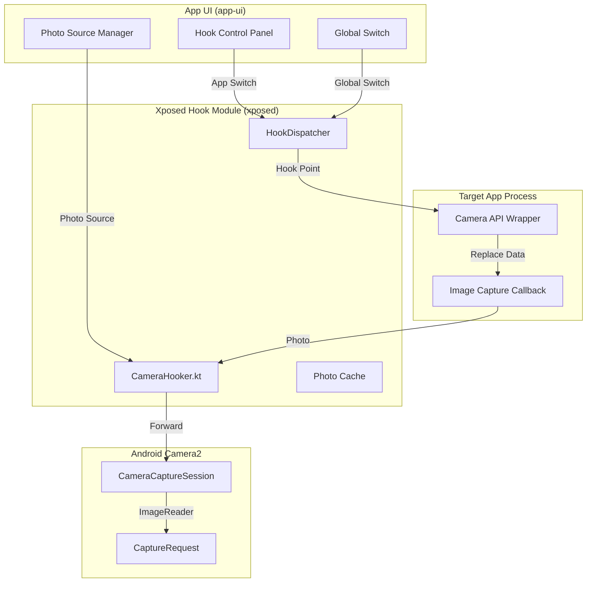

# Camera Hook Feature Design

Feature Name: hook-camera
Updated: 2026-11-03

## Description

在 LocationSpoofer 的 Xposed Hook 层增加相机模拟能力。通过 Hook 目标应用的相机 API 调用链路（拍摄前/拍摄后），返回由用户通过 App 界面上传的自定义照片，并支持按应用 Hook 开关和系统全局开关的双重控制。

## Architecture



## Components and Interfaces

### 1. Xposed Camera Hooker (`CameraHooker.kt`)

**路径**: `xposed/src/main/java/com/vincenthzr/locationspoofer/xposed/hooks/CameraHooker.kt`

- Hook 目标应用的相机 API 调用
- 处理 Hook 开关逻辑
- 管理拍前/拍后回调
- 控制器接口：
  ```kotlin
  interface CameraHookHandler {
      fun isGlobalEnabled(): Boolean
      fun isTargetAppEnabled(pkg: String): Boolean
      fun getPhotoSource(): PhotoSource?
      fun preCaptureHook(params: CaptureRequest): Boolean
      fun postCaptureHook(result: CaptureResult): Boolean
  }
  ```

### 2. Hook Dispatcher (`HookDispatcher.kt`)

- 管理目标应用列表
- 根据开关状态决定是否启用 Hook
- 管理 Hook 的生命周期

### 3. Photo Source Manager (`PhotoSourceManager.kt`)

- 从 App UI 层接收照片配置
- 管理照片缓存和读取
- 支持多张照片切换

### 4. Hook Control Panel (App UI)

- 系统开关 UI
- 目标应用列表 UI
- 照片选择 UI
- 开关状态显示

## Data Models

### TargetApp

```kotlin
data class TargetApp(
    val packageName: String,
    val enabled: Boolean,
    val version: String?,
    val lastHookAttempt: Long?,
)
```

### PhotoSource

```kotlin
data class PhotoSource(
    val id: String,
    val uri: String,
    val bitmap: Bitmap?,
    val selected: Boolean,
)
```

## Correctness Properties

- 全局开关关闭时，不 Hook 任何相机 API
- 应用开关关闭时，不修改指定应用的相机数据
- 没有照片源时，不修改相机数据
- 所有 Hook 操作应在应用主线程外执行，避免阻塞
- Hook 失败时应该恢复原始调用

## Error Handling

- 如果相机 API Hook 失败，恢复原始调用
- 如果照片源损坏，尝试重新获取或使用默认照片
- 如果目标应用不支持 Hook，跳过并按照原方式调用
- 记录 Hook 日志到 App 日志系统

## Test Strategy

- 单元测试：验证开关逻辑的独立性
- 集成测试：验证 Hook 器与目标应用的交互
- UI 测试：验证开关状态传递
- 功能测试：在支持的设备上验证拍照替换

## References

- [LocationHooker.kt](xposed/src/main/java/com/vincenthzr/locationspoofer/xposed/LocationHooker.kt)
- [AntiDetectionHooker.kt](xposed/src/main/java/com/vincenthzr/locationspoofer/xposed/hooks/AntiDetectionHooker.kt)
- [HookStatus.kt](xposed/src/main/java/com/vincenthzr/locationspoofer/xposed/diagnostics/HookStatus.kt)
