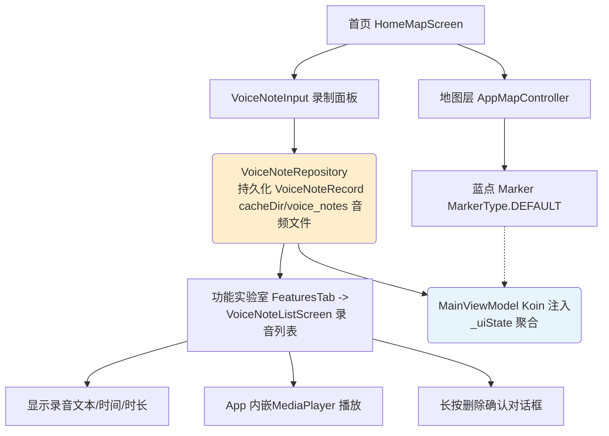

# Technical Design - Map Recording Dots

Feature Name: map-recording-dots
Updated: 2026-11-05

## Description

将首页地图上已录制的语音备注在地图上用默认蓝色 Marker（#388BFD）标记出来，并在功能实验室中提供录音文件查看入口，支持点击播放和长按删除，使录音数据在 map 与 lab 两个场景下可见、可操作。

## Architecture



- 录音数据层（`VoiceNoteRepository`）只保管一条数据源，页面侧通过 `MainViewModel` 向 UI 暴露列表。
- 地图层在首页 Tab 切换时清空重绘，蓝点作为独立 Marker 注入。
- 功能实验室区域新增"录音文件"卡片，展开后进入全屏录音列表子页面 `VoiceNoteListScreen`。

## Components and Interfaces

### 1. `app-ui/.../audio/VoiceNoteManager.kt`（数据层）

- 当前 `VoiceNoteRepository` 仅在 `VoiceNoteInput` 中逐次创建，不具备跨页面可见性。
- 需要将其提升为 `MainViewModel` 的受控状态：由 ViewModel 持有单一仓库并在协程中观察列表。
- 保留现有方法：`getAll()`, `saveNote()`, `deleteNote()`, `findNearby()`, `clearExpired()`, `updateDuration()`。

### 2. `app-ui/.../viewmodel/MainViewModel.kt`（状态层）

- 在 `MainViewModel` 中新增对语音备注列表的观测：
  - `_voiceNotes: MutableStateFlow<List<VoiceNoteRecord>>` 初始为 `emptyList()`，启动时从仓库读取全部未过期条目（按 `recordTime` 倒序，配合 `clearExpired` 过滤陈旧文件）。
  - 通过 `VoiceNoteInput` 保存成功后通过 `saveNote` 推送新条目。
- 在 `uiState` 中暴露 `voiceNoteCount: Int` 供功能实验室卡片计数，方法为 `_uiState.update { it.copy(...) }`。

### 3. `app-ui/.../components/AppMapView.kt`（地图标记层）

- `MarkerType` 的 `DEFAULT` 对应 `#388BFD`（高德经典蓝），与需求"小蓝点"吻合，当前已存在其余三种绿色/红色/橙色标记。
- `AppMapController.addMarker(lat, lng, title, type): AppMapMarker` 用于绘制蓝点，返回的 `AppMapMarker` 需扩展出：
  - **marker 消息**: 一个可复用的 `setOnMarkerClickListener(onClick: (lat: Double, lng: Double, title: String) -> Unit)`，由各引擎适配器（AMap / Baidu / Google）实现。
- AMap 适配器在 `init` 已注册 `setOnMapClickListener`；需新增地图中标记点击回调，避免与首页录制点单处理冲突：点击蓝点时仅上报标记事件，不触发录制面板。

### 4. `app-ui/.../screen/HomeMapScreen.kt`（首页地图）

- 在 `mapController != null` 且当前处于 Home Tab 时加载语音备注蓝点：
  - 使用 `mapController.addMarker(record.lat, record.lng, title, MarkerType.DEFAULT)`，按标记添加；逐个 Renderer 调用。
  - 记录点列表刷新逻辑绑定到 `LaunchedEffect(uiState.voiceNoteList)`，避免重复添加。
  - 添加点击回调后展示备注信息（录制时间、时长、文本）。
- 需与终相见面的录制对话框区分开：点击空白处打开录制面板，点击蓝点打开备注信息。

### 5. `app-ui/.../screen/tabs/FeaturesTab.kt`（功能实验室入口）

- 在现有的 `SectionHeader(lab_header_title)` 实验性功能区域下方，添加"录音文件"入口卡：
  - 使用 MiuixCard 布局和与相机 Hook 卡一致的结构；标题文字为 `lab_recording_files_title`，副标题/计数展示已录制数量 `voiceNoteCount`。
  - 点击后导航到子屏幕 `VoiceNoteListScreen`（`MainSubScreen.RecordingFiles`），通过 `MainScaffoldScreen` 已有机制传回 `onBack`。

### 6. `app-ui/.../screen/VoiceNoteListScreen.kt`（录音文件列表）

- 全页列表，展示所有未过期录音备注：
  - 每条记录显示：文本描述、录制时刻、语音时长、坐标位置。
  - 点击条目：通过 `MediaPlayer` 在 App 内嵌播放器中播放对应录音文件（无需系统播放器），提供可暂停/进度条/再次播放控件。
  - 长按条目：展示删除确认对话框，确认后调用 `repository.deleteNote(record)` 并登出列表。
- 列表需要使用 `LazyColumn` + 下拉刷新（`Scaffold` + `PullToRefresh`），与 `FeaturesTab` 中已有的采集列表风格一致。

### 7. `app-ui/src/main/res/values-*/strings.xml`（词条）

新增词条（中文 + 英文双语）：
- `lab_recording_files_title`（录音文件）
- `lab_recording_files_desc`（查看和管理已录制的语音备注，按坐标排序）
- `lab_recording_files_count`（已录制 %1$d 条）
- `voice_note_recording_time`（录制时间）
- `voice_note_duration`（时长）

## Data Models

```kotlin
data class VoiceNoteRecord(
    val path: String,       // cacheDir/voice_notes/record_<timestamp>.3gp
    val lat: Double,        // 录制时的地图坐标（GCJ-02）
    val lng: Double,
    val recordTime: Long,
    val text: String = "",
    val durationSeconds: Double = 0.0
)
```

- 当前项目内部统一使用 GCJ-02 坐标存储。
- `app-ui:VoiceNoteInput` 中已按 `lat`/`lng`/`recordTime`/`text` 序列化到 `voice_notes_repo` 共享偏好中，无需改动序列化格式。

## Correctness Properties

1. **视图与数据同步**：每次 `voiceNoteList` 变化或 Home Tab 进入地图时，地图上蓝点 Marker 的数量与列表条目数严格相等，不重复添加。
2. **坐标一致性**：蓝点坐标与 `VoiceNoteRecord.lat/lng` 完全一致，Marker 不随相机移动而漂移（只存储在各自自身坐标上）。
3. **删除同步**：录音文件删除后，关联的 Marker 自动从地图移除。
4. **计数展示**：功能实验室卡片的计数始终等于 `getAll()` 返回的未删除记录数。
5. **播放有效性**：每条录音文件可在 App 内嵌 `MediaPlayer` 中正常打开和播放；播放失败时提示用户当前格式不被支持。

## Error Handling

- **录音文件被外部清理程序删除**：`deleteNote` 时 `File.delete()` 返回 false，不视为错误，UI 仍正常展示已删除，但后续播放时若文件不存在则弹出"文件已不存在"（Toast）。
- **播放格式不支持**：`MediaPlayer` 无法创建或无法解码时，弹出"此格式暂不支持"的 Toast 提示，不崩溃。
- **MediaPlayer 释放**：播放过程中页面离开时必须调用 `release()` 释放资源，避免后台继续播放。
- **权限问题**：`getScheduler` 与文件系统操作失败时（没有 Storage 权限），当前 Android 版本无需额外权限，但需捕获 `SecurityException` 并提示用户。
- **录音未知异常**：在 `startRecording` 失败时的流程已经存在（Toast 提示），不需要额外逻辑。

## Test Strategy

1. **单元测试**：
   - `VoiceNoteRepository`：测试 `saveNote` / `deleteNote` / `getAll` / `clearExpired`（构造 `VoiceNoteRecord` 循环存放，检查返回数据）。
2. **UI 测试**（推荐 PMD 风格）：
   - 使用 `composeML` 或 `Espresso` 模拟 `FeaturesTab` 中录音卡片的点击，检查 `VoiceNoteListScreen` 是否被触发，并验证 `LazyColumn` 中第一条录音的文本/时间/时长。
   - 在 `HomeMapScreen` 上，测试"点击地图空白处显示录制面板"、"蓝点 Marker 显示"。
3. **地图标记测试**：
   - 使用 AMap 模拟器构建 `AMapControllerImpl`，以已知的经纬度添加 3 个绿色标记，使用 `setOnMarkerClickListener`  stalks，检查 3 个蓝点露出。
   - 刷新并验证没有重复 Marker（边界：一个 Recorder 下两个 Record 共享相同时间戳）。
4. **播放测试**：
   - 使用 `MediaPlayer` 在 App 内部打开录音文件，验证播放器控件能正确展示、暂停和恢复时长。
   - 验证无对应音频播放器时不崩溃、不闪现白屏。
5. **蓝点显示测试**：
   - 在首页地图录制一条语音备注后，蓝点 `DEFAULT` 标记应立即出现在对应坐标处，且与录制坐标一致。
   - 删除该备注后，蓝点应从地图中消失，避免标记残留。

## References

- [VoiceNoteInput.kt](/app-ui/src/main/java/com/vincenthzr/locationspoofer/ui/screen/note/VoiceNoteInput.kt)
- [VoiceNoteManager.kt](/app-ui/src/main/java/com/vincenthzr/locationspoofer/ui/audio/VoiceNoteManager.kt)
- [HomeMapScreen.kt](/app-ui/src/main/java/com/vincenthzr/locationspoofer/ui/screen/HomeMapScreen.kt)
- [FeaturesTab.kt](/app-ui/src/main/java/com/vincenthzr/locationspoofer/ui/screen/tabs/FeaturesTab.kt)
- [MainScaffoldScreen.kt](/app-ui/src/main/java/com/vincenthzr/locationspoofer/ui/screen/MainScaffoldScreen.kt)
- [AppMapView.kt](/app-ui/src/main/java/com/vincenthzr/locationspoofer/ui/components/AppMapView.kt)
- [AppUiState.kt](/app-ui/src/main/java/com/vincenthzr/locationspoofer/data/model/AppUiState.kt)
- [AMapEngineAdapter.kt](/app-ui/src/main/java/com/vincenthzr/locationspoofer/ui/components/map/AMapEngineAdapter.kt)
- [MapCoordinateUtils.kt](/app-ui/src/main/java/com/vincenthzr/locationspoofer/ui/components/map/MapCoordinateUtils.kt)
- [strings.xml](/app-ui/src/main/res/values/strings.xml)
